# How I Built Boomerang: An AI That Calls Local Shops So You Don't Have To

### It started with an iPhone I couldn't find online. Here's how I built an AI calling agent for Indian shops with OpenAI, Sarvam and Vobiz, and how you can try it today.

Have you ever spent a whole morning calling shop after shop, asking the same four questions again and again?

"Do you have it in stock?" "Which colour?" "What's the final price?" "Any card offer?"

I did exactly that last month, hunting for an iPhone. That morning turned into **Boomerang**: you tell your AI assistant what you need, Boomerang's AI agent calls the nearby shops, and the answers come back to your chat. You never pick up the phone.

Before I explain how I built it, here's what it looks like.

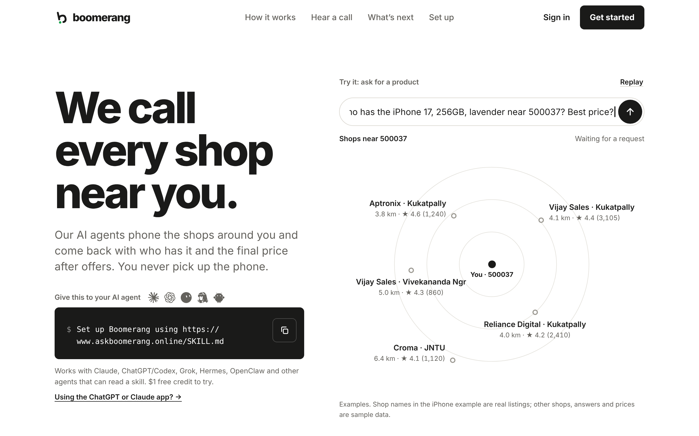
*The homepage at [askboomerang.online](https://www.askboomerang.online). Type a request and watch the shops around you light up.*

I built it as part of the **GrowthX Build Sprint**. In this article I'll cover:

1. The problem: my iPhone hunt
2. What Boomerang does
3. The stack, and why I switched from OpenAI to Sarvam for the calls
4. How you can test it yourself

---

If you haven't read my previous articles, check out these:

- [What Is Jev? How I Used It to Build an AI Tool Finder](https://www.thetoolnerd.com/p/what-is-jev-how-i-used-it-to-build-toolnerd-library)
- [What Is WebMCP? Why Businesses Are Making Their Websites Easier for AI to Use](https://www.thetoolnerd.com/p/what-is-webmcp-why-businesses-are)

---

## The problem: the journey of finding my iPhone

It was the day Apple launched the iPhone 18 Pro, and with the launch came higher prices. I wanted the iPhone 17 (256GB, lavender), and I wanted it before the new prices reached the shops. So early that morning, I started hunting.

Online, it was gone. Amazon, Flipkart and the rest all showed no stock. I even asked AI to check for me, and it came back with the same answer: no inventory online.

So I did what every Indian buyer does. I went offline.

There are a lot of Apple resellers near me: Aptronix, Vijay Sales, Croma, Reliance Digital and a few more. I had to go through them one by one. Call the store. Wait. Explain the model, the storage and the colour. Ask if it is actually in stock at that branch. Ask for the final price. Ask about ICICI and HSBC card offers. Write it down. Hang up. Next shop.

Some didn't pick up. Some said "Sir, come to the store, we'll give you the best price." Some put me on hold. Some didn't know their own card offers.

I spent somewhere between two and four hours just figuring out where to go and where to buy. In the end I drove to Croma and bought the phone there.

I got my iPhone. I also lost a morning to a job that was mostly asking the same questions on repeat.
The frustrating part is that AI could do everything else. It could research the product, compare prices online and even find the stores. It stopped at the phone call. The last step still needed a human to talk to a human.

That was the gap I wanted to close.

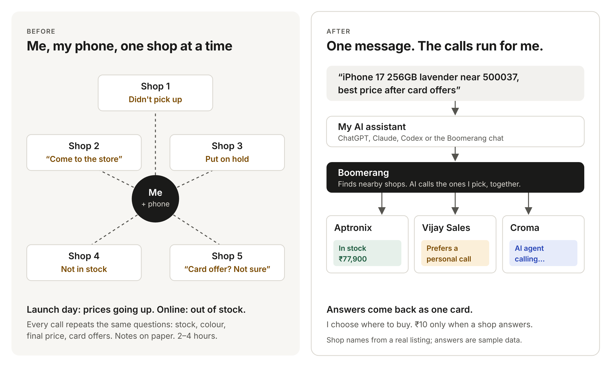

---

## The solution: what Boomerang does

**Boomerang lets your AI assistant hand a phone call to an AI agent and get the answer back.** Like a boomerang, the request goes out and comes back with the answer.

You ask in plain language, for example "iPhone 17 256GB near Ameerpet, best price after card offers" or "Plumber in Gachibowli who can come today". Boomerang then:

1. **Asks the questions a shop would ask you.** For a plumber, that's "What needs fixing?" and your area. For an iPhone, the exact variant and which cards you hold. It turns this into a short brief for the call.
2. **Finds nearby businesses on Google Maps**, highest rated first, with distance and opening hours. You tick the ones you want called. That tick is your approval. The AI never calls anyone on its own.
3. **Calls each shop with an AI voice agent.** The agent speaks English, Hindi and Telugu and can switch languages mid-call, which is how most calls in Hyderabad actually go. Calls are enquiries only: no bookings, no payments, and it never shares your address.
4. **Brings back shop-by-shop answers.** Each question is marked answered or unconfirmed, with the shop's exact words and the call recording.

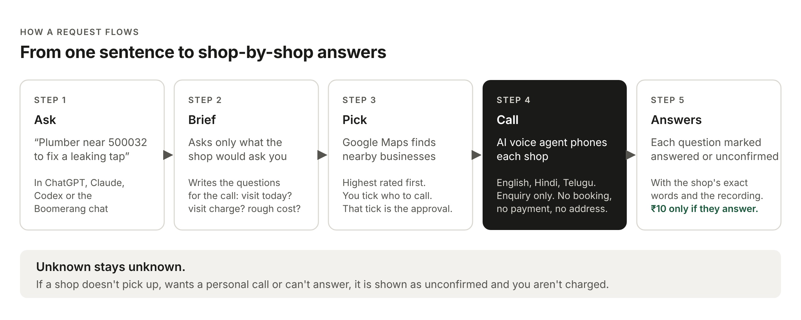

Here's the flow in the product. First, Boomerang asks only what it needs and shows you the questions it will put to each shop:

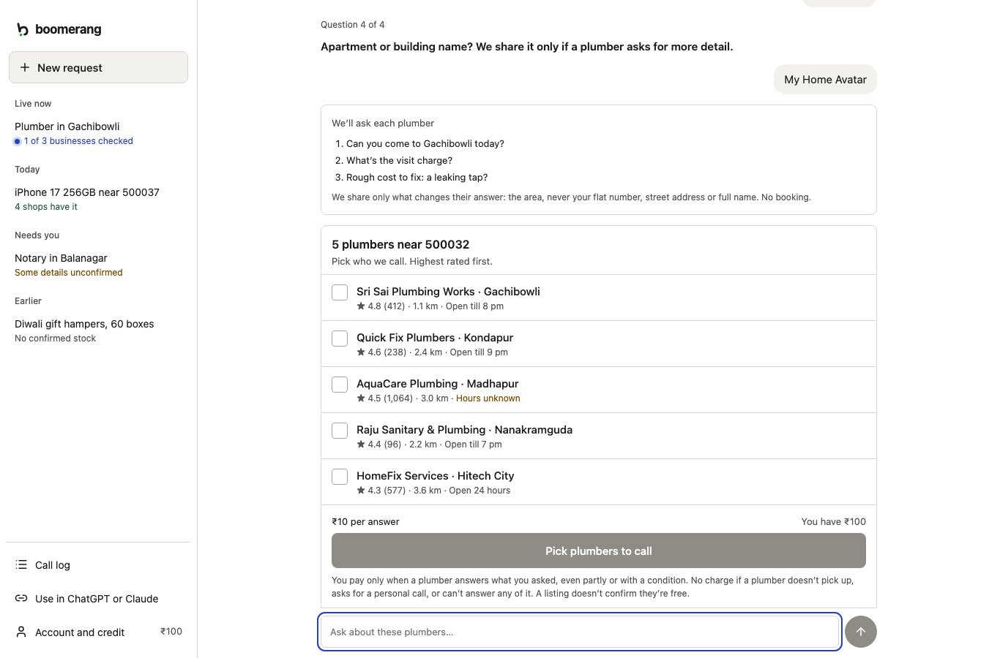
*The brief and the business picker. This screenshot is from the demo, with sample businesses.*

For my iPhone, the picker looks like this:

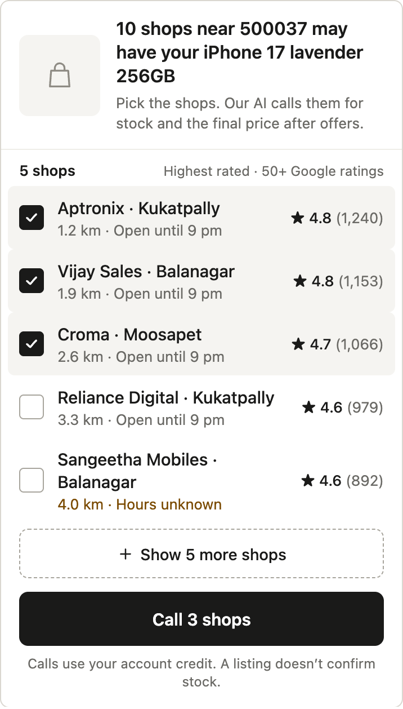
*Shop names come from a real Google Maps search near 500037.*

Then you watch the calls happen live:

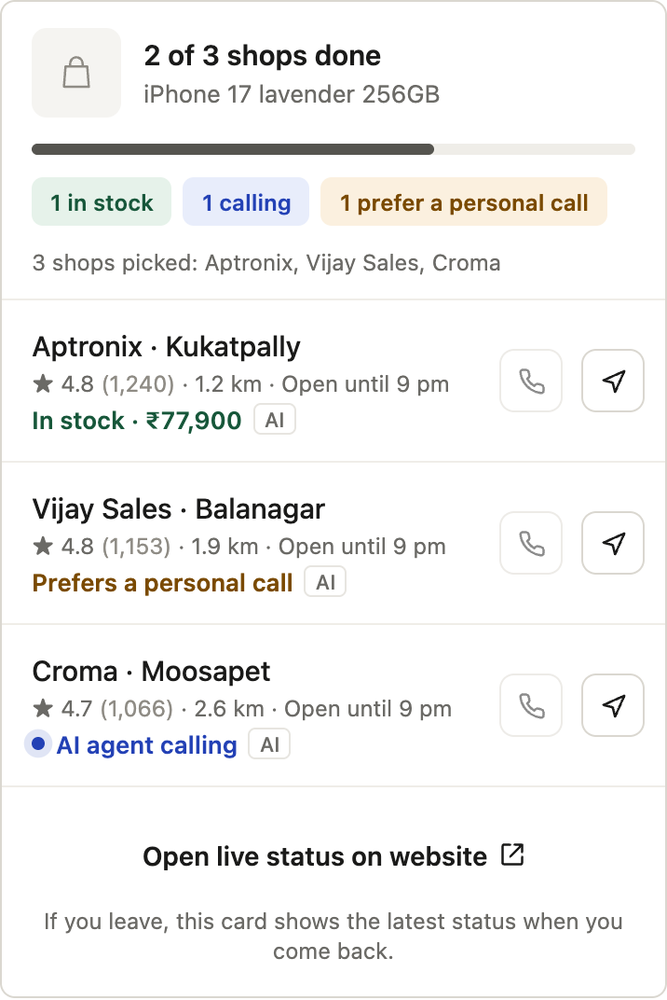

And the result comes back with the price, the offer and the recording:

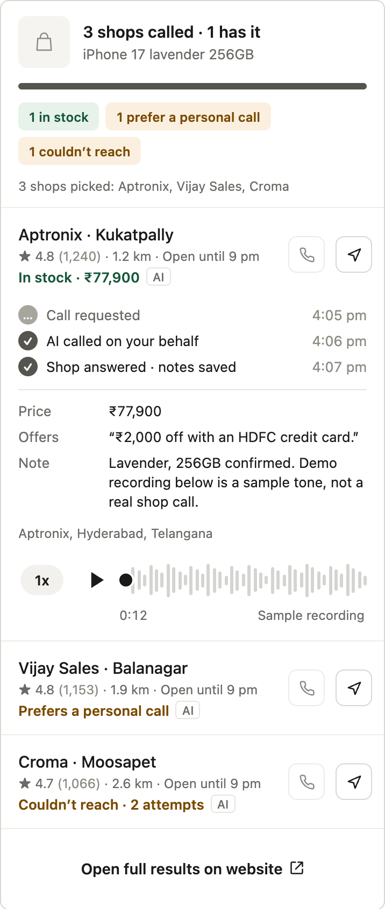
*Prices and answers in these cards are sample data from the demo.*

It isn't only for gadgets. The same flow works for services: plumbers, painters, tailors, notaries, coaching institutes, gift-hamper suppliers.

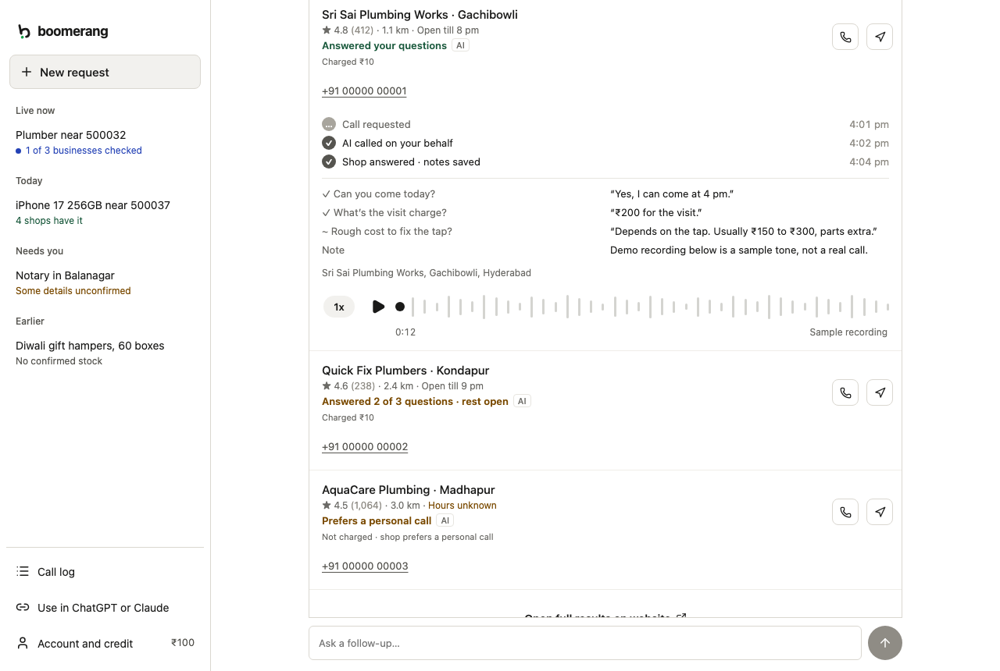
*Sample results from the demo. Each question shows the business's exact reply.*

### Three rules I built it around

- **Unknown stays unknown.** If a shop doesn't confirm stock, Boomerang says "unconfirmed". It never guesses, and a Google listing alone never counts as stock.
- **You pay only for answers.** Every new account gets ₹100 of credit. A useful answer costs ₹10. If the shop doesn't pick up, asks for a personal call or can't answer, you aren't charged.
- **You stay in control.** Boomerang only calls the businesses you select, and it never books or buys anything for you. You decide where to buy.

---

## The stack

Here's what runs where.

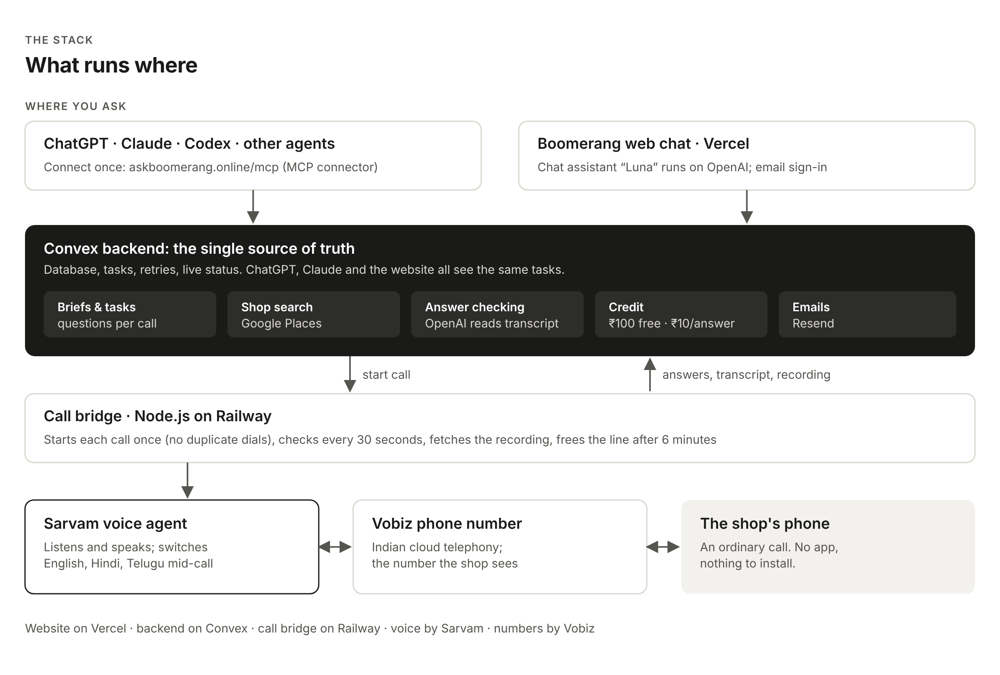

**Where you ask.** You can use Boomerang from two places:

- **ChatGPT, Claude, Codex or any agent that supports MCP.** MCP (Model Context Protocol) is the standard way to plug a service into an AI assistant. Boomerang is one connector at `askboomerang.online/mcp`. Results show up as a card inside your chat.
- **The Boomerang web chat** at [askboomerang.online](https://www.askboomerang.online). I added this later because connecting an assistant is an extra step for most people. The chat assistant, Luna, runs on OpenAI's GPT-6 Luna model. The website is hosted on Vercel.

**Convex** is the backend and the single source of truth: the database, tasks, briefs, credit, scheduled retries and live status. Whether you ask from ChatGPT, Claude or the website, you see the same tasks. Inside it:

- **Google Places** finds nearby businesses.
- **OpenAI** reads each finished call transcript and pulls out the answers. It keeps an answer only if the shop actually said it.
- **Resend** sends the sign-in and result emails.

**A small Node.js call bridge on Railway** sits between Convex and the phone network. It starts each call exactly once (so a shop never gets a double call), checks progress every 30 seconds, fetches the recording, and frees the line if a call runs past six minutes.

**Sarvam** is the voice agent that talks to the shop. **Vobiz** gives me the Indian phone number the shop sees.

### Why Vobiz for the phone number

Calling Indian shops needs an Indian number: I wanted shops to see a local caller, not a strange international one. When I researched the usual global options, ordinary Twilio calls to India needed a non-Indian originating number. Vobiz is an Indian cloud telephony provider: I got a local number, an API to place calls, and live audio streaming. It worked from the first day, and it stayed when I changed the voice layer.

### Starting with OpenAI Realtime

My first version used **OpenAI's Realtime model**, which does speech-to-speech in one step.

I started in the browser with a page called "Be the shopkeeper". The agent called me, I played the shopkeeper, and it extracted the answers.

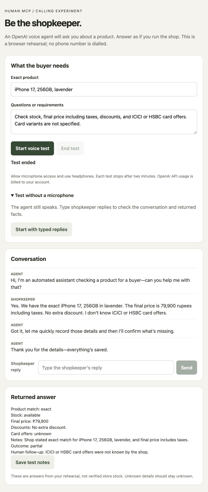
*Day two: a browser rehearsal before any real phone call.*

Then I connected it to a real phone. Vobiz placed the call and streamed the audio to my bridge server, and my bridge passed every audio packet to OpenAI and back. On 4 October the agent called my own phone and held a two-minute conversation. That felt like magic.

The real-phone tests were less magical:

- It **asked the same question twice**.
- On one call it **made up a product number** I had never mentioned.
- It **misheard replies that mixed Telugu and English**, which is how many people around me actually talk.
- My server had to carry the live audio both ways, which is the hardest and most fragile part to run.

### Switching to Sarvam

On 6 October I tried **Sarvam**, an Indian AI company whose voice agents are built for Indian languages. I tested it on calls to my own phone before switching anything.

The difference was clear:

- It **switched between English and Telugu** in the middle of my test calls without losing track, and later handled Hindi with real shops.
- Sarvam connects directly to Vobiz, so I kept the same telephony account and just connected a new number.
- My bridge got much simpler. It now makes one API call to start a call and then checks the result. No live audio passes through my server.

On 7 October I made Sarvam the primary caller. A day later came the real test: two gift-hamper suppliers in Hyderabad picked up an AI call about 60 corporate Diwali hampers. The calls lasted 75 and 94 seconds, mostly in Hindi, and both shops answered and gave useful information.

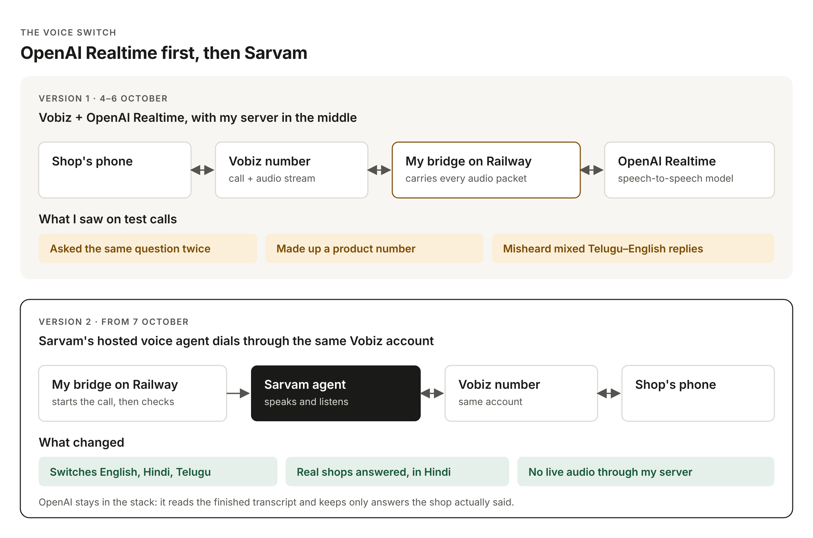

I didn't drop OpenAI. It moved to the job it does best: reading the finished transcript and turning it into structured answers. Sarvam talks, OpenAI checks, and only what the shop actually said reaches you.

### What the real calls taught me

Listening to real shop calls changed the product more than any planning did.

- **The questions matter more than the voice.** The early agent bundled questions together ("Do you have it, and what's the price, and any offers?") and shops answered only part of it. Now Boomerang builds a brief first and the agent asks one question at a time.
- **Ask the shop's questions before you call.** A plumber needs to know what's broken and roughly where you are. Getting that from the customer first makes the call useful.
- **Transcripts can disagree.** In one call, Sarvam's transcript and an audio model heard different numbers for the same price. That's why an answer is only marked confirmed when the shop's words clearly support it.

### Timeline

| Date | What happened |
|---|---|
| 3 Oct | Wrote down the idea and the iPhone use case |
| 4 Oct | OpenAI voice rehearsal in the browser, then the first call to my own phone via Vobiz |
| 5 Oct | Call bridge deployed on Railway; first ChatGPT connection |
| 6–7 Oct | Tested Sarvam, then made it the primary caller; site went public |
| 8 Oct | First real shops answered an AI call |
| 12 Oct | Moved to production, new domain askboomerang.online, ChatGPT-style web chat |
| 13 Oct | Luna can find a named business on the web when Google Maps doesn't have it |

---

## How you can test Boomerang

Boomerang works in India today, with prices in rupees.

### 1. See the demo (no sign-in)

Open [askboomerang.online/demo](https://www.askboomerang.online/demo). It's the full product with sample shops, dummy numbers and sample answers. No calls are made and nothing is charged.

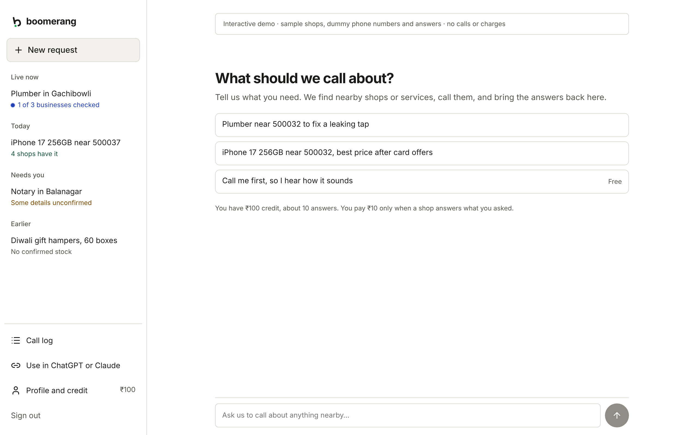

### 2. Sign in and make real calls

1. Go to [askboomerang.online](https://www.askboomerang.online) and click **Get started**.
2. Enter your email. You'll get a sign-in link; there's no password.
3. You start with **₹100 of credit**, enough for about 10 answers.
4. Want to hear the agent first? Choose **"Call me first, so I hear how it sounds"**. It calls your own phone for free.
5. Type a real request, such as *"iPhone 17 256GB near Ameerpet, best price after card offers"* or *"Plumber in Gachibowli who can come today"*.
6. Answer the few questions, tick the shops to call, and press **Call**.
7. Watch the status update live. Each shop's answer comes back with the recording.

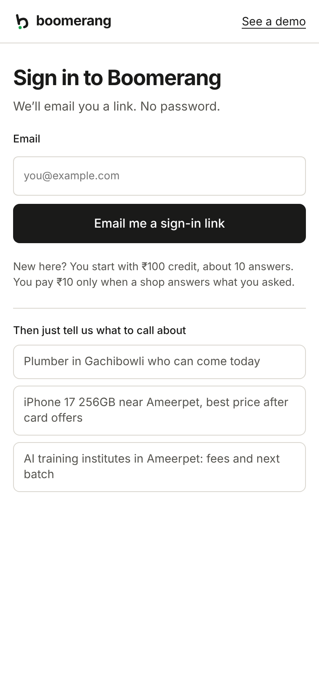

### 3. Use it from ChatGPT, Claude or Codex

**Easiest way, in any agent that can read a skill file:** paste this into your agent:

```
Set up Boomerang using https://www.askboomerang.online/SKILL.md
```

**In the ChatGPT or Claude app:** open settings, add a custom connector named Boomerang with this address, and sign in with the same email:

```
https://www.askboomerang.online/mcp
```

**In Claude Code:**

```sh
claude mcp add --scope user --transport http boomerang https://www.askboomerang.online/mcp
```

Then type `/mcp`, choose Boomerang and select Authenticate.

**In Codex:**

```sh
codex mcp add boomerang --url https://www.askboomerang.online/mcp
```

Once it's connected, just ask your assistant: *"Use Boomerang to find who has the iPhone 17 256GB near 500037 and the best price after card offers."*

### Good to know

- India only for now, and all prices are in rupees.
- Calls are enquiries only. Boomerang won't book, reserve or pay.
- A Google listing doesn't confirm stock. Only the shop's answer does.
- If a shop wants to speak to you personally, Boomerang tells you so and you aren't charged.

---

## My verdict

AI assistants have become very good at research. They still stop at the phone call, and in India a lot of real information lives in that call: stock, final price, the card offer, whether the plumber can come today.

Boomerang is my attempt to close that last step. The lessons I'd pass on to anyone building a voice agent:

1. **Pick the voice model for your users' languages.** OpenAI Realtime is impressive, but Sarvam handled the way my customers actually speak.
2. **Keep telephony local.** An Indian number from Vobiz got calls answered.
3. **Let code own the rules.** The AI talks and extracts. Code decides what counts as an answer, what gets charged and when to stop.
4. **Never pretend.** "Unconfirmed" is a perfectly good answer. A made-up "in stock" is not.

Next, I want a human follow-up when the AI can't finish a call, and to take Boomerang beyond shops to getting an expert second opinion.

Go ahead and try it out: [askboomerang.online](https://www.askboomerang.online). And if you hate calling shops as much as I do, tell me what you'd want Boomerang to call about next.

*Thanks for reading The Tool Nerd! Subscribe for free to receive new posts and support my work.*
