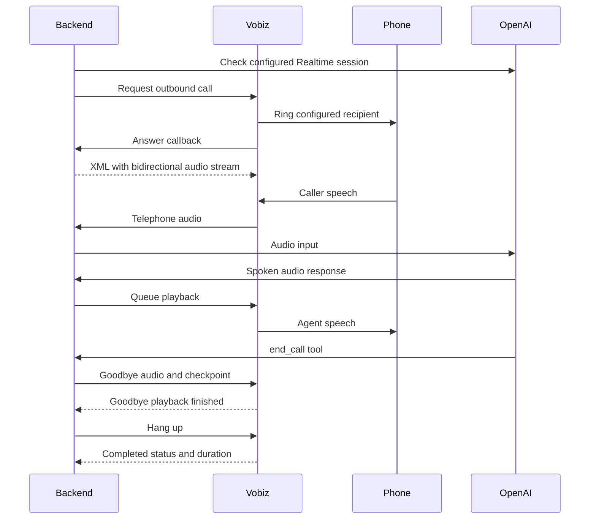

# Reusable voice calling: implementation and test record

Recorded 4 October 2026 for Human MCP. Two real calls to the founder established that Vobiz can connect our OpenAI voice agent to a telephone conversation. This is a reusable development building block, not the complete product calling service.

## What we built

Entry function: `createPhoneAgent(options)` in [phone-agent.cjs](../../voice-test/phone-agent.cjs). The existing [phone.cjs](../../voice-test/phone.cjs) command now uses this function. Importing either module does not open a server or dial a number.

Each instance owns one call, a callback server, an OpenAI connection and a result. Methods:

| Method / property | Purpose |
|---|---|
| `await agent.start()` | Checks OpenAI accepts the audio session, then starts the callback server. Does not dial. |
| `await agent.call()` | Requests one outbound call. Returns the current result, including the request ID when supplied by Vobiz. A second request on this instance is rejected. |
| `await agent.completed` | Resolves when the final Vobiz status callback arrives, or when the outbound request fails/has an unknown outcome. Inspect `status`; resolution alone does not mean a successful conversation. |
| `agent.getResult()` | Returns a copy of the latest result, so consumers cannot mutate internal state. |
| `await agent.stop()` | Stops the local service and sockets; requests hangup if an answered call is still active. |

Options include `publicUrl` (required public HTTPS address), `to`, `from`, `instructions`, `env`, `port` and `saveResult`. `to` and `from` default to the test numbers in the environment. `instructions` defaults to our conversation-test prompt. A custom prompt must explain when to invoke `end_call`; task-result tools have not been added to the telephone agent.

The result contains `model`, `requestId`, `callId`, `status`, `durationSeconds`, `endReason`, `errors` and approximate `transcript` entries. The default saver writes git-ignored `voice-test/phone-results/latest.json`. Supply `saveResult(result)` later to connect it to product storage. Snapshots can arrive repeatedly; an application must decide which updates and final results to persist. No credentials or phone numbers are included as explicit result fields; spoken personal information can still appear in transcripts.

### Example for a later backend

```js
const { createPhoneAgent } = require('./voice-test/phone-agent.cjs');

async function runConfiguredPhoneTest(publicUrl) {
  const agent = createPhoneAgent({ publicUrl });
  try {
    await agent.start();
    await agent.call(); // This line actually places the call.
    return await agent.completed;
  } finally {
    await agent.stop();
  }
}
```

Run with `.env` loaded, or supply `env` explicitly. For a future task, pass an authorised recipient through `to` and a task prompt through `instructions`. This example waits for a callback; production must add a durable deadline and reconcile missing callbacks. Do not infer that `stop()` can cancel a ringing request before a call ID exists.

## How the audio works



We use **native speech-to-speech**, not speech recognition → a text model → a separate speech generator. `gpt-4o-mini-transcribe` supplies approximate transcript notes alongside the conversation. The tested voice is `marin` and the selected conversation model is `gpt-realtime-2.1-mini`.

Vobiz and OpenAI exchange matching **mu-law audio at 8 kHz**, the telephone audio format, so this bridge needs no audio resampling. Vobiz receives `playAudio` messages for playback. On detected caller speech, the bridge clears queued audio and requests conversation truncation. This interruption handling exists but has not been comprehensively verified.

Closure is deliberate: `end_call` → finish the current model response → generate one goodbye → queue a named playback checkpoint → wait for `playedStream` → request Vobiz hangup. A 20-second fallback handles missing goodbye playback acknowledgment.

## Configuration and repeatable setup

Root `.env` contains these names; keep actual values private:

```env
OPENAI_API_KEY=...
OPENAI_VOICE_MODEL=gpt-realtime-2.1-mini
VOBIZ_AUTH_ID=...
VOBIZ_AUTH_TOKEN=...
VOBIZ_FROM_NUMBER=+91...
TEST_TO_NUMBER=+91...
PHONE_TEST_MAX_SECONDS=300
# Optional; current default is Telugu
PHONE_TEST_LANGUAGE=Telugu
```

Changing `OPENAI_VOICE_MODEL` or the limit requires a new agent instance/server restart. The time limit is shared by the provider request, audio stream and local timer; allowed range is 30–900 seconds.

1. Verify credentials with `GET https://api.vobiz.ai/api/v1/auth/me`, using `X-Auth-ID` and `X-Auth-Token`. Do not log the response: it includes secrets and account details.
2. Verify the caller number through `GET /api/v1/Account/{auth_id}/numbers`. This is lowercase `numbers`; the older `/Number/` route failed in our checks. Match the configured number privately against returned `items[].e164`.
3. Start a temporary audio connection with `cloudflared tunnel --url http://127.0.0.1:3211 --no-autoupdate`. Use its new HTTPS address for this run.
4. Run `node --env-file=.env voice-test/phone.cjs --public-url https://YOUR-TUNNEL` to check OpenAI and start the bridge without dialing. Check `/health`, then stop this process.
5. To place one authorised call, rerun that command with `--dial`. Every new process can place another call; do not automatically rerun it after an uncertain response.
6. Speak, request a language switch, and say goodbye. Check the final playback checkpoint, hangup response and Vobiz completed status. Compare transcript notes against what was actually said.
7. Stop the agent and temporary connection after testing.

No Vobiz number was purchased or reassigned by these tests. The phone test did not change inbound call routing. It did not enable call recording.

## Live test evidence

| Test | Observed | Conclusion |
|---|---|---|
| Account and model checks | Vobiz `/auth/me` HTTP 200; configured caller number found through `/numbers`; OpenAI model and telephone session accepted | Existing credentials and resources worked for this test |
| First call | Outbound HTTP 201; answered; caller and agent transcript events; completed callback at exactly **120 seconds** | Two-way conversation was possible; our two-minute cap cut the conversation off |
| Retry | Shared limit changed to **300 seconds**; outbound HTTP 201; caller and agent transcript events; completed after **151 seconds** | Conversation continued beyond the old cutoff |
| Retry closure | Log: `Ending test: goodbye playback finished`; Vobiz hangup **HTTP 204**; completed callback | Goodbye-triggered disconnection worked in this run |

The user confirmed receiving the first call and reported the abrupt cutoff. During that call, the caller requested a natural Telugu–English mix. One nonfatal OpenAI `invalid_value` event appeared; its exact field was not captured. The retry logs showed no OpenAI error, but this does not establish that the underlying edge case is fixed.

Evidence is the provider/API responses and event logs observed during this session, the local approximate transcript, and the user's report. We did not save an audio recording or a permanent full provider-log export. `latest.json` is overwritten by later runs; the first call's complete transcript is not retained there. These durations are provider callback values, not independently measured latency.

## Refactor verification

After extracting the reusable function, **12 automated checks passed**. New checks establish that imports are idle, startup does not dial, an explicit destination overrides the stored test destination, one instance rejects duplicate requests, and a final callback returns a copied result with duration. They use a local callback server and fake provider/model connections; no new real phone call was placed during the refactor.

Existing checks cover number validation, consistent configurable limits, goodbye checkpoint gating, browser route protections and browser closure. The two earlier live calls establish transport behaviour before the refactor; the extracted version still needs a future live regression call.

## Deferred improvements agreed with the user

- Start with **“Hello”**.
- Speak natural **Telugu–English** and **Hindi–English**, rather than awkward word-by-word mixing.
- Listen carefully, let the recipient finish, and handle corrections.
- Recognize requests to wait and a phone placed on hold; pause appropriately instead of continuing to question or prematurely ending.

These are recorded requirements, **not implemented improvements**. There is currently no reliable hold detector or hold state. Basic voice-activity detection is not enough to distinguish silence, hold music and a shopkeeper retrieving information.

## Boundary before product use

This function demonstrates calling feasibility. It does not yet confirm product stock/prices, return structured shop answers, enforce customer allowances, schedule retries, assign humans or charge credits. The browser shopping-agent tool is separate from this telephone test's `end_call` tool.

Before connecting it to product tasks, add durable task/store IDs and results, idempotency across processes, signed/validated provider callbacks, missing-callback reconciliation, secure hosting, concurrency management, permissions and budget checks. The current random callback paths are a development safeguard, not production webhook verification. `request_unknown` requires provider reconciliation; never treat it as permission to redial automatically. The `completed` promise does not itself solve a lost callback.

Next integration slice: attach a single authorised task to this function and return verified structured shop answers, after the deferred conversation behaviour is addressed.

## Provider references

- [Vobiz current account API](https://www.vobiz.ai/docs/account/retrieve-account)
- [Vobiz owned numbers](https://www.vobiz.ai/docs/account-phone-number/list-account-phone-numbers)
- [Vobiz outbound call example](https://www.vobiz.ai/integrations/pipecat/)
- [Vobiz bidirectional audio](https://www.vobiz.ai/docs/integrations/websockets)
- [Vobiz stream formats](https://www.vobiz.ai/docs/xml/stream)
- [Vobiz playback checkpoint](https://www.vobiz.ai/docs/xml/stream/checkpoint-event)
- [OpenAI Realtime Mini model](https://developers.openai.com/api/docs/models/gpt-realtime-2.1-mini)

The Vobiz native OpenAI SIP guide covers inbound calls; our outbound test instead uses the bidirectional audio bridge described above.
