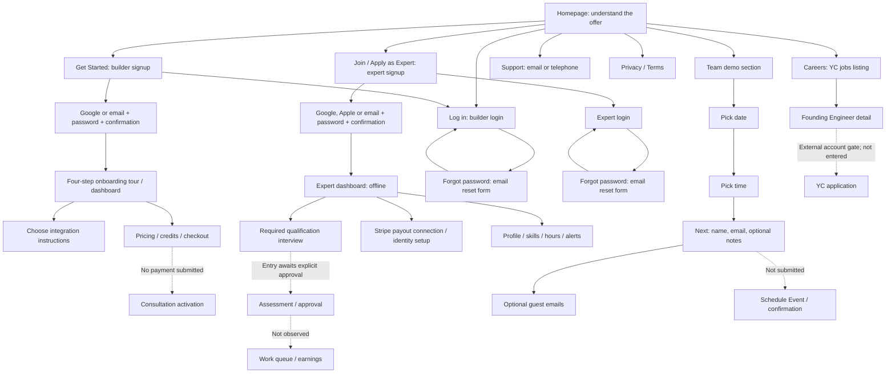

# Humwork: screen inventory and user journey

Inspected 3 October 2026 using the Codex browser. Aside was attempted but unavailable. The audit now includes actual builder account creation, onboarding, returning login, and signed-in dashboard screens. The browser's existing viewport was used; this is not a desktop/mobile comparison.

## Coverage

Observed: marketing homepage, all four explanation steps, five domain cards, builder signup/login/reset, expert signup/login/reset, embedded demo calendar/time/details/guests, support, privacy, terms, careers listing and job detail.

Builder account creation and returning email/password login were verified using mitra@agentmail.to with the user's approval. No email verification gate appeared. The four-step welcome tour, integration instructions, usage empty state, credits, settings, pricing and subscription checkout were captured. No purchase, subscription, real expert consultation, rating or booking was completed. Google and Apple provider flows were not entered. Expert login initially rejected builder credentials; at the next inspection the separate expert account was already signed in. Its dashboard, queue, history, profile, skills gate, hours, payouts gate and alerts were captured. The expert signup submission itself was not observed. Qualification interview entry was blocked by automatic approval review pending explicit permission. Qualification completion, approval, active availability and payout connection remain unverified. Social links and email/telephone links are recorded exits.

Open [the screenshot gallery](index.html) to browse captures at full size.

## Journey map

Solid paths above were observed; dotted paths show boundaries rather than verified outcomes.

## 1. New builder

1. Land on the homepage. The offer is on-demand experts for AI agents.
2. Understand the service through the animated example, supported platforms, metrics, four explanation steps, domain carousel, trust claims, and integration section.
3. Choose **Get Started** in the header, hero, or builder card. All point to the same builder signup URL.
4. Choose Google, or enter email, password, and confirmation, then Create Account. The email form has password visibility controls.
5. Returning users choose Sign In. Login offers Google or email/password, a password recovery link, and a link back to signup.
6. Recovery asks for email and offers Send reset link plus Back to sign in. Delivery and recovery completion were not tested.

**Observed end:** successful signup, four-step tour, dashboard and successful returning login. See the detailed observed onboarding below. Integration instructions and payment screens were viewed; external installation and purchases were not completed.

## 2. New expert

1. Choose **Join as Expert** in the hero or **Apply as Expert** in the lower card. Both point to expert signup.
2. Choose Google, Apple, or email/password/confirmation, then Create Account.
3. Existing experts follow Sign In to a separate expert login page. It offers Google, Apple, email/password, Forgot password, and Sign Up.
4. Recovery asks for an email and links back to sign-in.

**Observed end:** signed-in expert dashboard and account setup screens. The dashboard presents qualification and payout connection as required. Interview completion, identity verification, approval, work availability, actual jobs and earnings remain unverified. See the observed expert onboarding below.

## 3. Team buyer: book a demo

1. Reach the homepage's **Want Humwork for your team?** section. It contains an embedded Calendly scheduler; it loads after the surrounding page.
2. Pick an available day. Unavailable days are disabled.
3. Pick a time. The chosen time reveals **Next**.
4. Choose Next to see **Enter Details**: required name and email, optional preparation notes, and Add guests.
5. Add guests expands a guest-email field; the UI permits up to 10 additional guests.
6. The final action is **Schedule Event**. This was not clicked. No confirmation or calendar invitation was generated.

Observed example: 5 October 2026, 9:30–9:45 pm India Standard Time; 15-minute demo. Availability is a capture-time example, not a promise of current availability. A timezone control and back controls are visible. Booking terms and privacy links appear before the final action.

## 4. Support, trust, and careers

- **Support:** homepage/footer → support page → support@humwork.ai or +1 (628) 200-0624. The page asks users to include their account email and a short description. No ticket form was observed.
- **Contact:** footer → email composer addressed to founders@humwork.ai. Not opened or sent.
- **Trust:** footer → Privacy or Terms → public policy page. These routes also offer builder login/signup.
- **Careers:** footer → YC job listing → Founding Engineer detail (opens another tab) → Apply to role points to YC authentication. Application flow was not entered.
- **Social:** X and LinkedIn are external exits. Their profiles were not audited.

## Product loop described by the homepage

Agent gets stuck → calls Humwork → expert is matched → expert receives context and solves the issue → solution returns to the agent → agent continues.

This loop is a marketing explanation and animation, not a real consultation observed during this audit. The homepage describes MCP (a connection standard for AI tools), API (a software connection), and plugins as integration options; no public setup wizard was linked in the inspected navigation.

## Observed friction and gaps

1. **Expert and builder entry are separate sites.** Main-header Log in points to the builder login. Returning experts must reach expert signup and then Sign In, or know the expert login URL.
2. **No public pricing or detailed setup guide was found in the inspected navigation.** Visitors are sent to signup before these parts of the buying decision can be checked.
3. **Expert signup starts with a generic account form.** Assessment expectations, time commitment, approval sequence, and earning details are not explained on that form.
4. **The demo embed loads later than the page.** The section initially exposes the sales copy before the scheduler appears; it needs to be checked after loading, not recorded as missing.
5. **The fixed header overlaps content at the captured viewport.** Some explanation and booking captures show content beneath it. The four-step strip also clips its final label at this width.
6. **Trust details require a separate policy read.** Privacy discusses consultation-data usage and an email-based opt-out. The inspected account forms did not surface policy links in their visible text. This is an observation about those forms, not a legal conclusion.
7. **Matching and first reply are different promises.** Homepage copy says matching in under 30 seconds and average first reply under two minutes. A journey should distinguish these events.

## Screenshot inventory

| # | Screen / state | URL | Capture |
|---|---|---|---|
| 01 | Homepage, full page | https://humwork.ai/ | [Image](screenshots/01-home-full.jpg) |
| 02 | Builder signup | https://app.humwork.ai/signup | [Image](screenshots/02-builder-signup.jpg) |
| 03 | Builder login | https://app.humwork.ai/login | [Image](screenshots/03-builder-login.jpg) |
| 04 | Builder recovery | https://app.humwork.ai/forgot-password | [Image](screenshots/04-builder-reset.jpg) |
| 05 | Expert signup | https://expert.humwork.ai/signup | [Image](screenshots/05-expert-signup.jpg) |
| 06 | Expert login | https://expert.humwork.ai/login | [Image](screenshots/06-expert-login.jpg) |
| 07 | Expert recovery | https://expert.humwork.ai/forgot-password | [Image](screenshots/07-expert-reset.jpg) |
| 08 | Support | https://humwork.ai/support | [Image](screenshots/08-support.jpg) |
| 09 | Privacy, full page | https://humwork.ai/privacy | [Image](screenshots/09-privacy.jpg) |
| 10 | Terms, full page | https://humwork.ai/terms | [Image](screenshots/10-terms.jpg) |
| 11 | Demo calendar | https://humwork.ai/#book-demo | [Image](screenshots/11-demo-calendar.jpg) |
| 12 | Demo time options | Same embedded scheduler | [Image](screenshots/12-demo-times.jpg) |
| 13 | Selected time + Next | Same embedded scheduler | [Image](screenshots/13-demo-selected-time.jpg) |
| 14 | Demo attendee details, upper view | Same embedded scheduler | [Image](screenshots/14-demo-details.jpg) |
| 15 | Optional guests, notes and final action | Same embedded scheduler | [Image](screenshots/15-demo-guests.jpg) |
| 16 | Step 1: agent gets stuck | https://humwork.ai/#how-it-works | [Image](screenshots/16-how-it-works.jpg) |
| 17 | Step 2: expert matched | Same homepage section | [Image](screenshots/17-step-expert-matched.jpg) |
| 18 | Step 3: expert solves | Same homepage section | [Image](screenshots/18-step-expert-solves.jpg) |
| 19 | Step 4: agent continues | Same homepage section | [Image](screenshots/19-step-agent-continues.jpg) |
| 20 | Engineering carousel position | Homepage | [Image](screenshots/20-domains-engineering.jpg) |
| 21 | Strategy carousel position | Homepage | [Image](screenshots/21-domains-strategy.jpg) |
| 22 | Marketing carousel position | Homepage | [Image](screenshots/22-domains-marketing.jpg) |
| 23 | Design carousel position | Homepage | [Image](screenshots/23-domains-design.jpg) |
| 24 | Other-domain carousel position | Homepage | [Image](screenshots/24-domains-other.jpg) |
| 25 | Careers listing, full page | https://www.ycombinator.com/companies/humwork/jobs | [Image](screenshots/25-careers.jpg) |
| 26 | Job detail, full page | https://www.ycombinator.com/companies/humwork/jobs/9V8MtEV-founding-engineer | [Image](screenshots/26-career-detail.jpg) |
| 27 | Homepage hero | https://humwork.ai/ | [Image](screenshots/27-home-hero.jpg) |

The booking iframe originates at https://calendly.com/d/ctyc-4qy-wpw/humwork-demo. Long-page captures are full page; interaction captures are viewport images. Homepage videos are frozen frames and cannot document every animation frame.

## Next step

Inspect the expert interview setup after explicit approval. A paid consultation, external integration installation, expert assessment completion and payout identity verification remain outside the completed audit.

## Verified builder login and onboarding

### Signup and login

1. Email/password signup uses email, password and confirm-password fields. Password checks displayed 8+ characters, uppercase, lowercase and number.
2. Create Account briefly shows Creating account, then routes to `/dashboard`. No inbox verification was required in this flow.
3. The welcome tour opens automatically. Finish dismisses it.
4. Sign Out returns to `/login`. Signing in with the same email and password returns to `/dashboard` successfully. The completed tour did not automatically reopen.
5. Expert login with these builder credentials returns **Invalid email or password**. This observed behavior means builder credentials do not automatically provide expert access in this flow; it does not establish the underlying authentication architecture.

### Four-step tour

| Step | Title | Instruction | Next action |
|---|---|---|---|
| 1/4 | Your API Key | Copy the key for authenticated requests; keep it secure | Next |
| 2/4 | MCP Integration | Choose a platform and follow setup instructions | Next |
| 3/4 | Usage History | Track usage and questions | Next |
| 4/4 | Buy Credits | Purchase credits to continue using the API | Get Started |

Back and close controls are available; the sidebar offers Take your Tour to replay it. API keys were not copied, regenerated, installed or saved in this report. Captures retain the site's masked key display.

### Dashboard and setup branches

The default dashboard is API Setup. It shows zero credits, questions and chats, a zero success rate, a masked API key, expiry controls, integration choices and a Download agents.md action. The download was not used or installed into the workspace.

| Platform | Observed setup path |
|---|---|
| Claude Code — Plugin | Add marketplace → install plugin → re-authenticate in `/mcp` → browser sign-in; page states 30-day authentication |
| Claude Code — MCP | Add hosted HTTP server → re-authenticate → browser sign-in; alternative JSON configuration |
| Cursor | Open MCP settings → paste configuration using API key → restart |
| Windsurf | Open MCP/plugins settings → add configuration → save and restart |
| Codex CLI | Node requirement → config file → bridge configuration with API key → launch Codex |
| Lovable | Settings/connectors → add named MCP server URL → browser authentication |
| OpenClaw | Install/onboard → add MCP server → restart gateway → verify/test; separate model-provider key required |

These are instructions displayed by Humwork, not installations performed or compatibility claims independently verified by this audit.

### Activation and payment boundary

- Banner: **Get your first month free**; subscription is presented as necessary to start consulting experts.
- Buy Credits: 30 credits for $30; 110 for $100; Enterprise contact option. The page states each credit represents $1.
- Pricing return page `/pricing`: Starter $30/month with 30 credits; Pro $100/month with 110 credits; Enterprise custom pricing. Auto-refill is described.
- Subscribe on the dashboard opens a live Stripe Starter checkout. At capture it showed ₹0 today and ₹2,999.34/month starting the next month, with a currency conversion notice. These amounts are capture-time values.
- Checkout asks for card details and billing identity. No payment details were entered and the final Subscribe action was not clicked. No subscription was activated.
- Usage History shows **No questions asked yet** and directs the user to use the API key with an AI agent.
- Settings defaults to a 10-minute session: four minutes for matching and six minutes for live chat. Advanced wait-time override and account deletion controls are visible; neither was changed.

### Additional journey friction

1. Completing the tour is not activation: the user still needs external integration setup and a subscription/credits path before a real consultation can be observed.
2. The tour points to credits, while the persistent banner asks for a subscription. The relationship between subscription and extra credits is not explained in the tour itself.
3. Signup did not require email verification, despite the login identity being an email address.
4. Settings permits up to four minutes of matching at the default duration, while the homepage advertises matching in under 30 seconds. This may be a maximum timeout versus average expectation; the audit cannot establish actual performance.
5. Builder credentials were rejected by expert login, creating a separate account-entry step for users wanting both roles.

### Additional captures

| # | Screen / state | Capture |
|---|---|---|
| 28 | Builder signup prepared | [Image](screenshots/28-builder-signup-ready.jpg) |
| 29 | Tour: API key | [Image](screenshots/29-builder-tour-api-key.jpg) |
| 30 | Tour: integration | [Image](screenshots/30-builder-tour-integration.jpg) |
| 31 | Tour: usage history | [Image](screenshots/31-builder-tour-usage-history.jpg) |
| 32 | Tour: credits / finish | [Image](screenshots/32-builder-tour-complete.jpg) |
| 33 | API setup dashboard | [Image](screenshots/33-builder-dashboard.jpg) |
| 34 | Claude direct MCP | [Image](screenshots/34-builder-claude-mcp.jpg) |
| 35 | Cursor | [Image](screenshots/35-builder-cursor.jpg) |
| 36 | Windsurf | [Image](screenshots/36-builder-windsurf.jpg) |
| 37 | Codex CLI | [Image](screenshots/37-builder-codex.jpg) |
| 38 | Lovable | [Image](screenshots/38-builder-lovable.jpg) |
| 39 | OpenClaw | [Image](screenshots/39-builder-openclaw.jpg) |
| 40 | Usage History empty state | [Image](screenshots/40-builder-usage-empty.jpg) |
| 41 | Buy Credits | [Image](screenshots/41-builder-credits.jpg) |
| 42 | Settings | [Image](screenshots/42-builder-settings.jpg) |
| 43 | Live subscription checkout; not submitted | [Image](screenshots/43-builder-subscription-checkout.jpg) |
| 44 | Pricing | [Image](screenshots/44-builder-pricing.jpg) |
| 45 | Returning login prepared | [Image](screenshots/45-builder-returning-login.jpg) |
| 46 | Returning login success | [Image](screenshots/46-builder-login-success.jpg) |
| 47 | Expert rejects builder credentials | [Image](screenshots/47-expert-login-rejected.jpg) |
| 48 | Expert signup prepared; submission not observed | [Image](screenshots/48-expert-signup-ready.jpg) |

## Observed expert onboarding and activation gates

At the next browser inspection, mitra@agentmail.to was already inside the expert account. The intervening expert signup submission and any provider/verification steps were not observed; they must not be inferred from the dashboard.

### New expert dashboard

The account starts **Offline**, with zero earnings, zero answered tasks and no rating. Two required actions are presented:

1. **Complete Your Interview:** a 10–15 minute qualification interview to assess skills and enable matching.
2. **Connect Stripe:** payout account setup so completed work can be paid. The dashboard also labels this 10–15 minutes.

The empty queue explicitly says to finish the interview to get approved before tasks appear. Starting the interview was rejected by automatic approval review because it may persist assessment progress; explicit user permission has been requested. No answers, assessment results or approval screens were fabricated.

### Settings and supporting screens

| Screen | Observed fields or state | Gate / outcome |
|---|---|---|
| Profile | Photo upload, full name, account email, LinkedIn URL | Save Changes visible; no profile changes saved |
| Skills | Complete qualification interview to manage skills | Skills editing locked behind interview |
| Hours | Paused schedule, timezone Calcutta GMT+5:30, 09:00–20:00 rows for all seven days | Resume Schedule visible; not enabled |
| Payouts | Stripe Connect with account connection and identity-verification milestones | Connect Stripe visible; not connected |
| Alerts | Notifications Disabled; browser permission instructions | Enable Notifications not clicked |
| Queue | No items in queue | Questions and chats expected after approval |
| History | New / All / Answered / Expired filters and search | No history yet |
| Mobile App | Navigates to `/settings?tab=apps` | Rendered profile settings, not a dedicated mobile-app view in this inspection |

No banking details, identity documents, assessment answers, schedule changes, browser permissions or destructive actions were submitted. Stripe payout onboarding would require the user's real identity and payment setup; it was not entered.

### Expert journey

Expert signup/login → offline dashboard → qualification interview → approval → configure profile/skills and work hours → connect payout account and verify identity → become available → receive queue tasks → complete work → history and earnings.

Dashboard, setup screens and empty states were observed. Assessment, approval, identity verification, going online, tasks and earnings are gated future stages. Their exact sequence after interview cannot be verified from the inspected screens.

### Expert friction

- New experts see two substantial required tasks before any work appears; qualification explains approval, while Stripe explains payment eligibility.
- Skills cannot be edited until qualification; a blank skills screen is therefore an explicit gate, not an empty profile form.
- The default schedule is paused and the account is offline; account creation alone does not make the expert available.
- Several expert actions render as generic text rather than semantic buttons or links, reducing accessibility and automation clarity.
- Mobile App navigated to the apps query but displayed profile settings; no app download screen was observed.

| # | Expert capture | Image |
|---|---|---|
| 49 | Dashboard / onboarding gates | [Image](screenshots/49-expert-dashboard.jpg) |
| 50 | Empty queue | [Image](screenshots/50-expert-queue.jpg) |
| 51 | Empty history | [Image](screenshots/51-expert-history.jpg) |
| 52 | Profile settings | [Image](screenshots/52-expert-settings.jpg) |
| 53 | Skills qualification gate | [Image](screenshots/53-expert-skills.jpg) |
| 54 | Paused work hours | [Image](screenshots/54-expert-hours.jpg) |
| 55 | Payout connection / verification gate | [Image](screenshots/55-expert-payouts.jpg) |
| 56 | Notification permission gate | [Image](screenshots/56-expert-alerts.jpg) |
| 57 | Mobile App navigation renders profile | [Image](screenshots/57-expert-mobile-app.jpg) |
